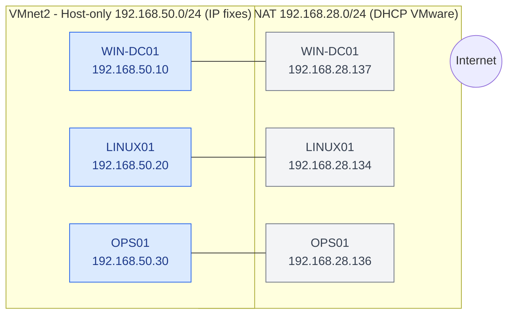

# Adressage IP

## Principe

Le laboratoire utilise deux réseaux virtuels VMware, un par usage :

| Réseau | Type VMware | Sous-réseau | DHCP | Usage |
|---|---|---|---|---|
| VMnet2 | Host-only | 192.168.50.0/24 | Désactivé | Réseau du projet : administration, DNS, supervision |
| VMnet8 | NAT | 192.168.28.0/24 | Activé (VMware) | Accès Internet uniquement : paquets et mises à jour |

Le réseau `192.168.50.0/24` est une valeur de laboratoire. Il est isolé du réseau de l'établissement (host-only), donc sans risque de conflit d'adresses.

## Schéma d'adressage



Chaque machine est représentée deux fois, une par carte réseau : le trait relie les deux adresses d'une même VM.

## Plan d'adressage

### Réseau du projet (VMnet2) : adresses fixes

| Machine | Adresse IP | Masque | Fonction |
|---|---|---|---|
| WIN-DC01 | 192.168.50.10 | /24 | AD DS et DNS |
| LINUX01 | 192.168.50.20 | /24 | Services Linux |
| OPS01 | 192.168.50.30 | /24 | Automatisation et supervision |

Paramètres communs :

- domaine Active Directory : `infraready.test` ;
- serveur DNS du laboratoire : `192.168.50.10` ;
- aucune passerelle sur cette carte.

### Réseau NAT (VMnet8) : adresses attribuées par DHCP

| Machine | Adresse IP relevée | Usage |
|---|---|---|
| WIN-DC01 | 192.168.28.137 | Accès Internet (mises à jour Windows, téléchargement de Windows Exporter) |
| LINUX01 | 192.168.28.134 | Accès Internet (`apt`) |
| OPS01 | 192.168.28.136 | Accès Internet (`apt`, installation d'Ansible, Prometheus, Grafana) |

Ces adresses sont données par le DHCP de VMware : elles peuvent changer après un redémarrage ou une longue extinction. Elles ne doivent donc **jamais** servir de référence dans l'inventaire Ansible, les playbooks ou la supervision : seules les adresses `192.168.50.x` sont utilisées.

## Résolution de noms

| Nom | Adresse | Remarque |
|---|---|---|
| `win-dc01.infraready.test` | 192.168.50.10 | Enregistrement DNS du contrôleur de domaine |
| `infraready.test` | 192.168.50.10 | Domaine |

Sur Ubuntu, la carte du lab pointe vers `192.168.50.10` pour le domaine `infraready.test` uniquement. Les autres requêtes passent par le DNS de VMware (`192.168.28.2`) via la carte NAT.

Vérification depuis OPS01 ou LINUX01 :

```bash
nslookup win-dc01.infraready.test
nslookup infraready.test
```

Les deux commandes répondent `192.168.50.10`.

## Points de vigilance

- **Un seul enregistrement DNS par machine.** Le contrôleur de domaine a d'abord inscrit les deux adresses (`192.168.50.10` et `192.168.28.137`). L'enregistrement de la carte NAT a été désactivé et le serveur DNS limité à l'adresse du lab, pour que les machines Linux obtiennent toujours une adresse joignable.
- **Pare-feu Windows.** Les requêtes ping entrantes sont bloquées par défaut sur WIN-DC01 : la règle ICMPv4 a dû être activée pour tester la connectivité depuis Ubuntu.
